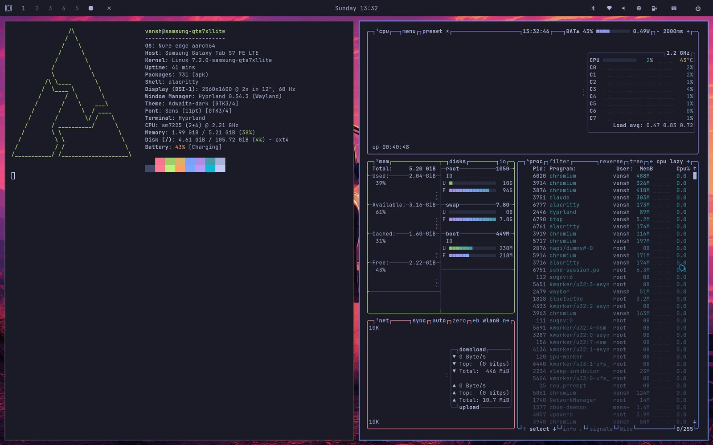
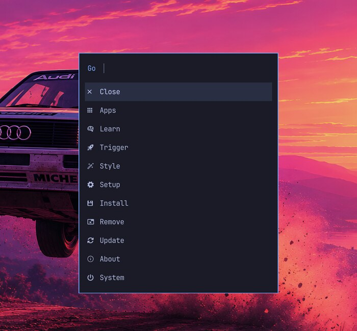
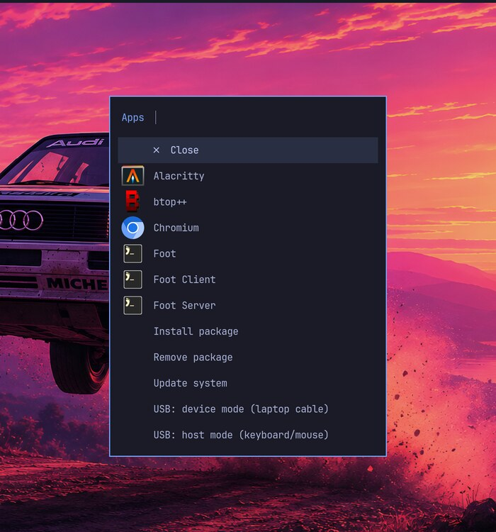
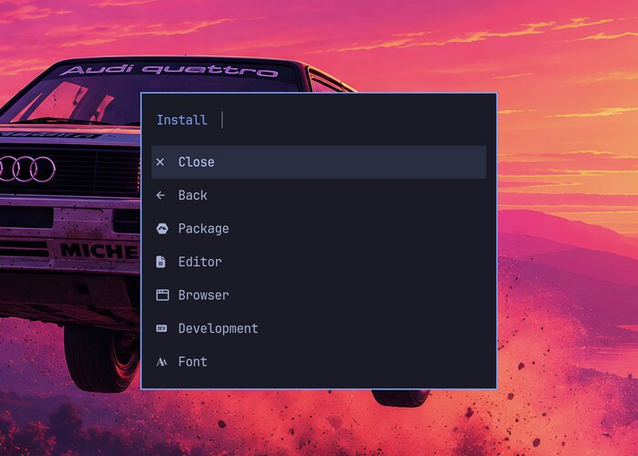

# Omarchy on the Galaxy Tab S7 FE

**A Samsung Android tablet turned into a real Linux workstation**: mainline Linux 7.2 ([postmarketOS](https://postmarketos.org)) on the Galaxy Tab S7 FE, with an [Omarchy](https://omarchy.org)-style Hyprland desktop — same keybindings, menu, bar and Tokyo Night theme as on my laptop, adapted for touch.




- **Mainline kernel, not Android's** — display, touch, GPU (Adreno 619), Wi-Fi, Bluetooth, battery and charging all running on Linux 7.2.
- **11 kernel patches** on top of the community port: SM5714 charger control written for this port, the community touchscreen driver wired up, and fixes for display corruption, power-off and battery reporting.
- **Omarchy, ported to Alpine + touch** — the menu is generated from Omarchy's own definition file; Close/Back rows, 44 px touch targets, tap-to-use Wi-Fi and Bluetooth, and an on-screen keyboard that pops up in text fields make it usable without a keyboard.
- **A real dev box** — VSCodium with Python, Chromium, and Claude Code running natively on the tablet.

> ⚠️ **Unlocking the bootloader wipes the tablet and trips Samsung Knox permanently** (Secure Folder, Samsung Pass/Wallet/Health stop working for good). Charging is basic (no fast charging). Read [Known limitations](#known-limitations) before you start.

| Omarchy menu | Apps (touch) | Install submenu |
|---|---|---|
|  |  |  |

**Guides:** [How the tablet was converted to Linux](docs/PORTING.md) · [Ricing it](docs/RICING.md)

## What works

| Hardware | Status | Notes |
|---|---|---|
| Display (FocalTech FT8203 panel, DSC) | ✅ | Himax HX83121A panel variant is **not** supported |
| Touchscreen | ✅ | FocalTech FT8203 over SPI |
| GPU (Adreno 619) | ✅ | freedreno / Turnip, Hyprland runs accelerated |
| Wi-Fi (WCN3990) | ✅ | |
| Bluetooth | ✅ | needs `linux-firmware-qca` |
| Battery level | ✅ | SM5714 fuel gauge (level, status, voltage, current, temperature) |
| Power off | ✅ | stays off **with the USB cable unplugged** |
| USB networking / SSH over USB | ✅ | USB port defaults to device mode |
| USB host (OTG) | ⚠️ | controller works, but the SM5714's 5 V boost (OTG mode) is not driven yet: use a powered OTG hub |
| Charging | ✅ | basic SM5714 charger control at the stock limits (1.8 A in, 2.1 A, 4.38 V), temperature limits, watchdog; no fast charging (SM5440 direct charger / USB-PD) |
| Audio, camera, S Pen, sensors | ❌ | not working yet |

## Engineering notes

The interesting part of this project was the debugging. A few of the problems, and how they were tracked down:

- **Vertical streaks and broken glyphs.** The panel runs Display Stream Compression; the driver enabled DSC *block prediction*, which this panel decodes differently. Turning it off (patch 0004) fixed the picture, matching vishalbala-nps's upstream change.
- **Power-off hung, the RTC was unreachable.** The mainline device tree put the PMK8350 PMIC at SPMI SID 0 — on top of the PM6350. Samsung's stock DTB shows it at SID 6. One `#define` (patch 0005) fixed power-off, a duplicate power-key controller and the real-time clock.
- **Kernel panic on first boot: no `/sbin/init`.** The flashed image held an almost empty root filesystem. Cause: the desktop's automounter (`udiskie`) mounted pmbootstrap's loop partitions mid-build, so writes never reached the image file. Lesson: verify the image (inode count, `/sbin/init`) before it touches the device.
- **Black screen with the backlight on.** Turning the display off made the touch driver pulse the reset line it shares with the panel (the FT8203 is one touch+display chip), and the panel was never re-initialised. The power button and idle now only drop the backlight.
- **"Plugged in, still discharging."** The bootloader leaves the SM5714 charger at 500 mA while the screen alone draws ~1.5 A. Reading Samsung's GPL charger driver gave the register map and stock limits; patch 0008 applies them (1.8 A / 2.1 A / 4.38 V), follows Samsung's temperature rules, runs the charger watchdog, and reports charging from the charger's own status bits.
- **Charging flip-flopped every 10 seconds.** The "battery temperature" came from the SM5714 package, which is also the charger: 1.7 A instead of 1 A raised it 2.7 °C in 6 seconds, and the 41 °C limit kept chasing the charger's own heat. Samsung's device tree pointed to the real battery thermistor on the PM6150L ADC; patch 0009 uses it.
- **VSCodium's terminal wouldn't open.** Alpine's package shipped `node-pty` with Windows and macOS binaries only; building it for musl/arm64 fixed it, and `tablet-update` rebuilds it after upgrades.
- **White grain, then the screen went off.** Every backlight change is a DCS command sent over the DSI link, and some of them corrupt frames (`dsi_err_worker status=5`) until the next redraw; several in quick succession can hang the SoC. Logging the DSI status registers showed all four lanes starving: the driver re-applied the link clock rates before every command, and because the PLL can't hit the requested rate exactly, that reprogrammed the PLL under the running video. Patch 0011 stops it (0 errors in 71 brightness changes, down from about 1 in 3).
- **The menu couldn't be closed by touch.** Logging showed taps outside the launcher never reach the bar while it is open, so Close/Back moved *into* the menu.

## What is in this repo

```
pmaports/device/testing/
  linux-samsung-gts7xllite/     mainline 7.2 kernel + 11 patches (see below)
  device-samsung-gts7xllite/    deviceinfo (boots from RECOVERY, rootfs in USERDATA)
  firmware-samsung-gts7xllite/  ADSP/CDSP/modem/Wi-Fi/GPU/touch firmware
dotfiles/                       Hyprland, Waybar, fuzzel, Alacritty, mako, VSCodium... + tablet-* scripts
system/                         Hyprland tinydm session, power-key, Chromium and SSH firewall settings
tools/gen-tablet-menu.py        generates tablet-menu from Omarchy's omarchy-menu.jsonc
tools/omarchy-theme.sh          re-colours the tablet with any Omarchy theme (docs/RICING.md)
docs/                           PORTING.md (the full story), RICING.md (customising the look)
install.sh                      sets up the desktop on a freshly flashed tablet over SSH
```

### Kernel patches

Base: [vishalbala-nps/linux](https://github.com/vishalbala-nps/linux) `panel` branch (fork of [sm6350-mainline](https://github.com/sm6350-mainline/linux)), which carries the device tree and the FT8203 panel driver.

| Patch | What it does |
|---|---|
| 0001 | FocalTech FT8203 SPI touchscreen driver (from Marker284) |
| 0002 | Panel driver stability fixes: keep panel powered, brightness in LP mode (Marker284) |
| 0003 | DTS: SPI6 controller, touchscreen node, USB peripheral mode |
| 0004 | Panel: DSC block prediction off — fixes vertical streaks and broken glyphs |
| 0005 | DTS: PMK8350 is SID 6 (stock layout) — fixes power-off hang, duplicate PON, RTC |
| 0006 | SM5714 fuel gauge driver (vishalbala's, merge-conflict leftovers removed, STATUS added) |
| 0007 | DTS: USB OTG with a manual role switch (`tablet-usb-mode`) |
| 0008 | SM5714 charger control: stock currents/float voltage, 41/50/0 °C limits, 90 s watchdog, charging status from the charger |
| 0009 | SM5714: battery temperature from the battery's thermistor (PM6150L ADC), not the charger chip, so charge limits stop flip-flopping |
| 0010 | DSI: no 2–4 ms delay before commands on panels with a short gap between frames |
| 0011 | DSI: don't reprogram the link clocks before every command (`msm.xfer_skip_clk_rate`, switched on after boot by `system/etc/local.d/dsi-clk-fix.start`); fixes the white grain and freezes on brightness changes |

## Installing

You need a Linux PC with [pmbootstrap](https://docs.postmarketos.org/pmbootstrap/) and `heimdall` (odin4 never completed its handshake with this tablet; heimdall works).

1. **Unlock the bootloader.** Developer options → *OEM unlocking*, then in Download mode (power off, hold **Vol Up + Vol Down**, plug in USB) **long-press Vol Up** and confirm. This wipes the tablet. Let it boot Android once, online, until `KG STATUS` is not blocking.
2. **Add the packages** to your pmaports checkout:
   ```sh
   cp -r pmaports/device/testing/* "$(pmbootstrap config aports)"/device/testing/
   pmbootstrap init        # vendor samsung, device gts7xllite, UI console, init openrc
   ```
3. **Build the image.** If your desktop auto-mounts drives (Omarchy runs `udiskie --automount`), **pause it first** — it mounts the image partitions mid-build and you get an empty rootfs:
   ```sh
   pkill -f 'udiskie --automount'
   pmbootstrap install --no-sparse
   ```
   Check the image before flashing (the root partition must contain `/sbin/init`), then make the sparse image yourself:
   ```sh
   img2simg samsung-gts7xllite.img userdata.img
   avbtool make_vbmeta_image --flags 2 --padding_size 4096 --output vbmeta.img
   ```
4. **Flash** in Download mode. On the warning screen **short-press Vol Up** first — the USB handshake only works on the actual *Downloading…* screen:
   ```sh
   heimdall flash --RECOVERY boot.img --VBMETA vbmeta.img --USERDATA userdata.img
   ```
   Android keeps the BOOT partition, Linux boots from RECOVERY.
5. **Boot Linux**: hold **Vol Down + Power** ~7 s, then **Vol Up + Power** and **let go at the Samsung logo** (a volume key held while Linux starts drops into the initramfs debug shell). Leave the first boot alone for a few minutes while it grows the filesystem.
6. **Install the desktop** from this repo (Wi-Fi or USB):
   ```sh
   ./install.sh user@samsung-gts7xllite.local     # or user@172.16.42.1 over USB
   ```
   Copy Omarchy's wallpapers into `~/.local/share/wallpapers` (link one as `current`) and `omarchy.ttf` into `~/.local/share/fonts` — they are Omarchy's artwork, so they are not included here.

## Using it

The desktop starts at boot (tinydm autologin into Hyprland).

| Keys | Action |
|---|---|
| Super + Space | Omarchy menu (also: tap the logo in the bar) |
| Super + Alt + Space | Apps |
| Super + Escape | System menu (also: ⏻ in the bar) |
| Power button | screen (and touch) off / on |
| Super + Return | Terminal (Alacritty) |
| Super + Shift + Return / B | Chromium |
| Super + Shift + N | VSCodium |
| Super + W | Close window (also: ✕ in the bar) |
| Super + 1…0 | Workspaces (+ Shift: move window) |
| Super + Ctrl + C / O / H | Capture / Toggle / Hardware menus |
| Super + Ctrl + B | Bluetooth (blueman) |
| Super + Ctrl + U | USB host ↔ device |
| Super + Ctrl + K | On-screen keyboard (also: keyboard icon in the bar) |
| Print / Super + Print | Screenshot / colour picker |
| Super + K | All keybindings |

Commands on the tablet:

| Command | |
|---|---|
| `tablet-update` | `apk upgrade`, then copies a changed `/boot/boot.img` to RECOVERY and verifies it |
| `tablet-pkg-install` / `tablet-pkg-remove` | Omarchy-style fuzzy package installer for `apk` |
| `tablet-usb-mode host\|device` | switch the USB-C port role |
| `tablet-fix-vscodium-terminal` | Alpine's VSCodium ships no Linux `node-pty`; this builds it |

SSH: `ssh user@samsung-gts7xllite.local` (avahi) or `ssh user@172.16.42.1` over the USB cable.

## Known limitations

- **Charging is basic**: up to about 9 W (5 V, 1.8 A) — no fast charging, the SM5440 direct charger and USB-PD negotiation are not driven. A laptop USB port gives less; with the screen on the battery may only hold or charge slowly. With a cable plugged in, *power off* powers straight back on into Linux, so unplug first.
- **Power button** only turns the backlight off (and blocks touch); the tablet keeps running. DPMS is avoided on purpose: switching the panel off makes the FT8203 touch driver pulse the reset line it shares with the panel, and with the panel driver's `keep_powered` the display is not re-initialised, so it can stay black.
- **During the first minute after boot**, brightness changes can still glitch the picture: the display fix (patch 0011) only switches on 60 s after boot, because enabling it from the start froze the tablet.
- Only the **FocalTech FT8203** panel variant works.
- Suspend is untested; the lock screen cannot be used with the on-screen keyboard, so idle only turns the backlight off.
- `hyprland-guiutils` and Omarchy's walker/omarchy-shell are not packaged for Alpine; the menu uses fuzzel, the bar uses Waybar.
- Packages come from Alpine (musl): software built for glibc distributions usually does not run.

## Security

What `install.sh` locks down:

- **SSH is key-only** once a key is in `~/.ssh/authorized_keys` (run `ssh-copy-id` first; without a key, password logins stay on so you are not locked out).
- **SSH only from the USB cable and the local network** (`system/etc/nftables.d/49_ssh_local.nft`). On a phone hotspot the tablet gets a public IPv6 address, and postmarketOS's firewall accepts SSH from anywhere.
- The menu's `sudo -n` actions (reboot, shutdown, USB mode, Bluetooth restart, time sync) get a narrow passwordless rule, `/etc/sudoers.d/80-tablet-actions`.

Known risks, by design:

- **Autologin, no lock screen**: anyone holding the tablet has your session. The root filesystem is not encrypted, and an unlocked bootloader lets anyone flash their own image.
- **Passwordless `sudo` for everything**, if you set it up (`NOPASSWD: ALL`, as on the author's tablet): anything running as your user — a browser exploit, a bad npm package or editor extension, an AI coding agent — becomes root without a prompt and can rewrite the boot image. Delete that sudoers file to require your password; the narrow rule above keeps the menu working.
- **Chromium stores saved passwords with `--password-store=basic`** (no keyring on this setup): effectively plain text to any process running as your user.

## Recovering / going back to Android

Keep Samsung's firmware for your build (e.g. from [Bifrost](https://github.com/zacharee/Bifrost)). Flash the stock `recovery.img` and `vbmeta.img` back with heimdall and wipe USERDATA, or flash the full firmware. Knox stays tripped.

## Credits

- [vishalbala-nps](https://github.com/vishalbala-nps/linux) — SM-T735 device tree, panel driver, SM5714 fuel gauge, [firmware](https://github.com/vishalbala-nps/firmware-samsung-gts7xllite)
- [Marker284](https://github.com/Marker284/samsung-gts7xllite-display-touch) — touchscreen driver, panel fixes, GPU bring-up, porting notes
- [sm6350-mainline](https://github.com/sm6350-mainline/linux) and the Fairphone 4 postmarketOS port
- [postmarketOS](https://postmarketos.org) / Nura and [Alpine Linux](https://alpinelinux.org)
- [Omarchy](https://omarchy.org) by DHH — keybindings, menu structure, look and Tokyo Night theme

## License

Scripts and configs in this repo: MIT (see `LICENSE`). Kernel patches are GPL-2.0, like the kernel. Firmware is proprietary and is downloaded from its upstream, not included.
